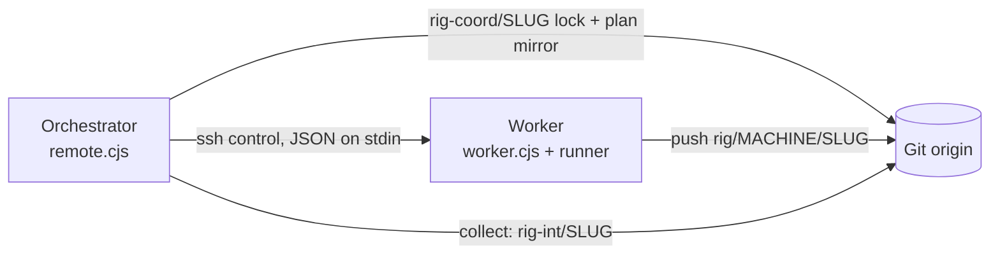

# System Architecture

**Last Updated**: 2026-10-15
**Version**: 1.0.0
**Project**: Rig

## Overview

Rig implements a multi-agent AI orchestration architecture where specialized agents collaborate through a file-based communication protocol. The system enables developers to leverage AI assistance throughout the entire software development lifecycle - from planning and implementation to testing, review, and deployment.

## Architectural Pattern

### Pattern Classification
**Primary Pattern**: Microservices-inspired Agent Architecture
**Secondary Patterns**:
- Command Pattern (slash commands)
- Observer Pattern (agent communication)
- Strategy Pattern (workflow selection)
- Template Method Pattern (agent workflows)

### Design Philosophy
- **Decoupled Agents**: Each agent is independent and specialized
- **File-Based Communication**: Agents communicate via markdown reports
- **Workflow Orchestration**: Coordinated agent execution (sequential/parallel)
- **Configuration-Driven**: Agents and commands defined in markdown
- **AI-First Development**: Leverage AI at every stage of SDLC

## System Components

Rig is organized in layers:

1. Core Layer
2. Agent Layer
3. Command Layer
4. Workflow Layer
5. Skills Layer
6. Integration Layer
7. Data Layer

Full catalog (responsibilities, files, technology stack): [System Components](../reference/system-components.md).

## Component Interactions

### Typical Interaction Flow: Feature Implementation

```
┌─────────────┐
│    User     │
└──────┬──────┘
       │ /rig:implement "add auth"
       ↓
┌─────────────────────┐
│   Command Parser    │
└──────┬──────────────┘
       │ Parse command + args
       ↓
┌─────────────────────┐
│  Planner Agent      │
└──────┬──────────────┘
       │ Spawn researchers
       ↓
┌──────────────────────────────────┐
│  Researchers (Parallel)          │
│  - Auth strategies               │
│  - Security best practices       │
│  - Integration patterns          │
└──────┬───────────────────────────┘
       │ Reports to planner
       ↓
┌─────────────────────┐
│  Planner Agent      │
└──────┬──────────────┘
       │ Create plan
       │ Save to ./plans/
       ↓
┌─────────────────────┐
│   Main Agent        │
└──────┬──────────────┘
       │ Read plan
       │ Implement code
       ↓
┌─────────────────────┐
│  Tester Agent       │
└──────┬──────────────┘
       │ Write & run tests
       ↓
┌─────────────────────┐
│ Code Reviewer Agent │
└──────┬──────────────┘
       │ Review quality
       ↓
┌─────────────────────┐
│  Docs Maintainer    │
└──────┬──────────────┘
       │ Update docs
       ↓
┌─────────────────────┐
│ Git Operator Agent  │
└──────┬──────────────┘
       │ Commit & push
       ↓
┌─────────────────────┐
│   User (Result)     │
└─────────────────────┘
```

### Agent Communication Example

```
plans/<plan-name>/reports/251026-from-planner-to-main-auth-plan-report.md
    ↓
Main Agent reads plan
    ↓
Implements features
    ↓
plans/<plan-name>/reports/251026-from-main-to-tester-auth-impl-report.md
    ↓
Tester reads implementation details
    ↓
Runs tests
    ↓
plans/<plan-name>/reports/251026-from-tester-to-main-test-results-report.md
```

## Data Flow Diagrams

### Command Execution Flow

```
User → CLI → Parser → Command Def → Agent Workflow
                                         ↓
                        ┌────────────────┴────────────────┐
                        ↓                                 ↓
                Sequential Execution              Parallel Execution
                        ↓                                 ↓
                Agent A → Agent B → Agent C    Agent A + Agent B + Agent C
                        ↓                                 ↓
                        └─────────────┬───────────────────┘
                                      ↓
                              Collect Results
                                      ↓
                              Present to User
```

### File-Based Communication Flow

```
Agent A (Planner)
    ↓ Writes
./plans/<plan-name>/plan.md
    ↓ Reads
Main Agent
    ↓ Implements
Code Changes
    ↓ Writes
./plans/<plan-name>/reports/251026-from-main-to-tester-impl-report.md
    ↓ Reads
Tester Agent
    ↓ Executes
Tests
    ↓ Writes
./plans/<plan-name>/reports/251026-from-tester-to-main-results-report.md
    ↓ Reads
Main Agent (next steps)
```

### Documentation Update Flow

```
Code change / /rig:docs update
    ↓
Legacy layout? ── yes ──> migrate-docs-to-diataxis-layout.cjs (dry-run → ask → --apply)
    ↓
docs-maintainer (loads diataxis-writer)
    ↓ per page
Pick type → place in tutorials/ | how-to/ | reference/ | explanation/ (or project/)
    ↓
Write / split mixed pages → classify-doc.sh (advisory) → quality checklist
    ↓
Update docs/README.md index
    ↓
validate-docs.cjs (links, code refs, layout warnings)
```

Layout rules: `.claude/skills/docs/references/diataxis-docs-layout.md`.

### Agent State

Agents keep no state outside the file system ([ADR 0001](decisions/0001-agent-state-lives-in-files.md)):

- **Durable**: plans, phase status and reports in `plans/`; docs and devlog in `docs/`. Source of truth across sessions.
- **Session**: active plan in `$TMPDIR/rig-session-<id>.json`, written by `set-active-plan.cjs`; Claude Tasks hydrated from phase files and synced back.
- **Disposable**: caches in `$TMPDIR/rig-*.json` (git info, usage limits, notification throttle).

### Parallel Work Isolation

`/rig:team` gives each implementation dev its own git worktree (`isolation: "worktree"`) and assigns file ownership by glob, so parallel agents in one session do not edit the same files. The lead merges the worktree branches at the end. Rules: `.claude/rules/team-coordination-rules.md`.

### Multi-Machine Execution (rig:remote)

`rig:remote` (`.claude/skills/remote/`, [ADR 0002](decisions/0002-multi-machine-remote-orchestration.md)) runs plan phases and test commands on other machines. One orchestrator owns the plan. Workers run a headless agent per phase in a Rig-dedicated clone. Git is the only data channel; ssh is control only. No agent sits between the orchestrator and a worker: the orchestrator drives the deterministic CLI over ssh.



| Component | Location | Role |
|---|---|---|
| Orchestrator CLI | `scripts/remote.cjs` | register, machines, setup, doctor, run, dispatch, status, cancel, review, collect, takeover |
| Worker CLI | `scripts/worker.cjs` | prepare, baseline, info, start, status, list, cancel, exec, facts |
| Machine registry | `~/.claude/rig-machines.json` (orchestrator only), written by `register` | Machine ids, ssh target, OS, paths; optional `repos` map (origin key -> clone path, one clone per project; a project missing from `repos` gets `no-clone`); no secrets. Format: `.claude/skills/remote/references/registry-format.md` |
| Coordination branch | `rig-coord/<slug>` (orphan, single writer) | Plan mirror and orchestrator lock; claimed by create-only push |
| Worker branch | `rig/<machine>/<slug>` (runner pushes only) | Agent commits after the owns/denylist guard |
| Integration branch | `rig-int/<slug>` (collect only) | Reviewed worker branches merged in phase order |
| Run state | `~/.rig/runs/<runId>/` on each worker | `run.json`, heartbeat, log; the source of run truth (no ledger) |

**Run lifecycle**: dispatch starts a detached process (tmux session `rig-<runId>` on macOS/Linux; scheduled task `rig-<runId>` on Windows, headless S4U by default). The runner checks the owns/denylist guard before every push and pushes whenever HEAD advances. A heartbeat older than 90 s marks the run `lost`.

| Failure | Handling |
|---|---|
| Unreachable worker, protocol mismatch | Exit 5; `doctor` diagnoses; no blind retry |
| Spec branch is not `rig/<self>/<slug>` | Worker rejects the spec before any work starts (exit 2). `self` is `RIG_MACHINE`, or the lowercased hostname |
| Second run on the same clone | Refused at start (`busy`, exit 1). Busy markers are per clone, so runs on other clones of the same machine proceed |
| Coordination fetch error | Fail closed, exit 3 |
| Second orchestrator claims a plan | Refused, exit 3; `takeover` requires user decision |
| Owns violation, denylisted path | `failed:owns-violation`; not pushed; not auto-retried |
| Worker clone config or hooks changed | `failed:hooks-tampered`; clone quarantined |
| Reviewed branch got a new commit | `collect` refuses (`reviewedSha` mismatch) |
| Merge conflict in collect | Exit 4; resolve in `.rig/int-<slug>` and rerun |
| Killed or rebooted worker | Run shows `lost`; re-dispatch with a new run id |

Operator steps: [Run a plan across machines](../how-to/run-plan-across-machines.md).

## Security Architecture

### Security Layers

**Layer 1: Pre-Commit Security**
- Secret scanning (git-operator agent)
- Credential detection
- .gitignore validation
- Environment file exclusion

**Layer 2: Code Security**
- Input validation enforcement
- SQL injection prevention
- XSS protection patterns
- OWASP Top 10 awareness

**Layer 3: Agent Security**
- No logging of sensitive data
- Sanitized error messages
- Secure credential handling
- API key protection

**Layer 4: Communication Security**
- File system permissions
- Report sanitization
- Context isolation
- Clean handoffs
- Remote workers: ssh control only with validated tokens; worker output fenced as UNTRUSTED; owns/denylist guard before push; orchestrator-only review gate (`rig:remote`, ADR 0002)

### Secret Management

**Environment Variables**:
```
.env (local, gitignored)
.env.example (template, committed)
```

**API Keys**:
- Never hardcoded
- Environment variable injection
- Secure storage systems in production

**Credentials**:
- Password hashing (bcrypt, argon2)
- Token-based authentication
- Secure session management

## Scalability Considerations

### Horizontal Scalability

**Parallel Agent Execution**:
- Independent researchers run simultaneously
- No shared state between agents
- File-based coordination
- Scalable to N agents

**Workflow Parallelization**:
- Multiple feature branches
- Concurrent issue resolution
- Parallel test execution
- Independent documentation updates

### Vertical Scalability

**Context Management**:
- Repomix for code compaction
- Selective context loading
- Chunked file processing
- Efficient token usage

**Performance Optimization**:
- Lazy loading of skills
- Cached MCP responses
- Incremental documentation updates
- Optimized file I/O

## Deployment Architecture

### Development Environment

```
Developer Machine
├── Claude Code CLI
├── .claude/ (configuration)
├── Git repository
└── Node.js runtime
```

### CI/CD Pipeline

Releases are manual:

```
npm test                                         # every hook test file (scripts/run-hook-tests.cjs)
    ↓
node scripts/prepare-release-assets.cjs <version>
    ├─→ .claude/metadata.json (version, file list)
    └─→ dist/rig.zip
    ↓
gh release create|upload v<version> dist/rig.zip  # no npm publish
```

`antigravity-sync-check.yml` runs on every push and PR to `main` and fails when `.agent/` or `GEMINI.md` differ from a fresh sync.

### Production Usage

```
User Project
├── .claude/ (from template)
├── docs/ (generated)
├── plans/ (generated)
├── src/ (user code)
└── tests/ (user tests)
```

## Monitoring & Observability

### Agent Activity Tracking

**Logs**:
- Agent invocations
- Command executions
- Workflow progress
- Error occurrences

**Reports**:
- Agent communication files
- Implementation plans
- Research findings
- Test results

**Metrics**:
- Command execution time
- Agent success rates
- Test pass/fail ratios
- Documentation coverage

### Quality Metrics

**Code Quality**:
- Test coverage percentage
- Type safety compliance
- Linting pass rate
- Security scan results

**Process Metrics**:
- Planning to implementation time
- Code review turnaround
- Documentation freshness
- Commit message compliance

## Failure Handling

### Error Recovery Strategies

**Agent Failures**:
- Graceful degradation
- Error reporting to user
- Rollback mechanisms
- Retry logic for transient errors

**Workflow Failures**:
- Checkpoint saving
- Partial progress preservation
- Clear failure messages
- Recovery suggestions

**Communication Failures**:
- File write retries
- Report validation
- Missing report detection
- Timeout handling

## Extension Points

Agents, skills, and workflows are markdown files under `.claude/`, so extending Rig needs no code changes. Steps: [Extend Rig with Agents and Skills](../how-to/extend-rig-with-agents-and-skills.md).

## Performance Considerations

### Optimization Strategies

**Token Efficiency**:
- Repomix for codebase compaction
- Selective context inclusion
- Efficient prompt engineering
- Response caching where possible

**Execution Speed**:
- Parallel agent spawning
- Async file operations
- Lazy skill loading
- Minimal context switching

**Resource Usage**:
- File system efficiency
- Memory management for large files
- Cleanup of temporary files
- Optimized git operations

## Future Architecture Evolution

Rig is developed independently and stays a set of files under `.claude/` with no runtime service. Direction and priorities live in the [Roadmap](../project/roadmap.md). Changes that would add a database, daemon, or remote execution must first revisit [ADR 0001](decisions/0001-agent-state-lives-in-files.md).

## References

### Internal Documentation
- [Project Overview PDR](../project/overview-pdr.md)
- [Codebase Summary](../reference/codebase-summary.md)
- [Code Standards](../reference/code-standards.md)
- [System Components](../reference/system-components.md)
- [ADR 0001: Agent State Lives in Files](decisions/0001-agent-state-lives-in-files.md)
- [Documentation index](../README.md)

### External Resources
- [Claude Code Documentation](https://docs.claude.com/)
- [MCP Documentation](https://modelcontextprotocol.io/)
- [Semantic Versioning](https://semver.org/)

## Unresolved Questions

1. **Concurrent sessions on one plan**: worktrees isolate parallel agents inside one `/rig:team` session, but two separate sessions (or two people) editing the same plan files have no locking. Is worktree discipline enough, or is a lock needed?
2. **Performance baselines**: no measured latency or token baselines per workflow yet (also open in the [PDR](../project/overview-pdr.md) and [Roadmap](../project/roadmap.md)).

Resolved: agent state beyond the file system → no ([ADR 0001](decisions/0001-agent-state-lives-in-files.md)). Revisited: multi-machine execution is now `rig:remote`, git as transport, state still in files ([ADR 0002](decisions/0002-multi-machine-remote-orchestration.md)).
