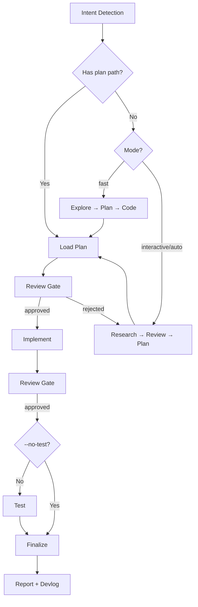

# Implement - Plan-Driven Feature Implementation

End-to-end implementation with automatic workflow detection.

**Principles:** YAGNI, KISS, DRY | Token efficiency | Concise reports

## Usage

```
/rig:implement <natural language task OR plan path>
```

If no flag is provided, the mode follows the task tier (see Size Tiers): Standard runs `fast`, Large runs `interactive`. Explicit flags always override.

**Optional flags to select the workflow mode:** 
- `--interactive`: Full workflow with user input (default for Large)
- `--fast`: Skip research, explore→plan→code (default for Standard)
- `--full`: Force the Large tier: research, reviewed plan, full gates (interactive workflow)
- `--parallel`: Multi-agent execution
- `--no-test`: Skip testing step
- `--auto`: Auto-approve all steps

**Example:**
```
/rig:implement "Add user authentication to the app" --fast
/rig:implement path/to/plan.md --auto
```

## Size Tiers

Tier definitions live in `.claude/skills/implement/references/orchestration-protocol.md` (Trivial / Standard / Large); this skill covers Standard and Large. Misjudged scope is the usual failure, so classify first and say the tier in one line.

- **Standard:** a short plan (chat or `--fast` plan file) must exist before code; implement in the main session; tester/reviewer gates below are lighter.
- **Large:** a reviewed plan must exist before code (`/rig:plan`), full gates below.
- Risk signals (auth, data/migrations, infra, public API or schema) force Large.
- User override wins: "just code it", "skip planning" or `--full` is respected; `--full` forces the Large pipeline.

<HARD-GATE>
Standard and Large: do not write implementation code until a plan exists (and, for Large, has been reviewed). Unexamined assumptions in "simple" multi-file tasks cost more than the plan. `--fast` skips research but still plans.
</HARD-GATE>

## Anti-Rationalization

| Thought | Reality |
|---------|---------|
| "This is too simple to plan" | Simple tasks have hidden complexity. Plan takes 30 seconds. |
| "I already know how to do this" | Knowing ≠ planning. Write it down. |
| "Let me just start coding" | Undisciplined action wastes tokens. Plan first. |
| "The user wants speed" | Fastest path = plan → implement → done. Not: implement → debug → rewrite. |
| "I'll plan as I go" | That's not planning, that's hoping. |
| "Just this once" | Every skip is "just this once." Use the tier table or the user override instead. |

## Smart Intent Detection

| Input Pattern | Detected Mode | Behavior |
|---------------|---------------|----------|
| Path to `plan.md` or `phase-*.md` | code | Execute existing plan |
| Contains "fast", "quick" | fast | Skip research, explore→plan→code |
| Contains "trust me", "auto" | auto | Auto-approve all steps |
| Lists 3+ features OR "parallel" | parallel | Multi-agent execution |
| Contains "no test", "skip test" | no-test | Skip testing step |
| Contains "--full" | interactive | Forces Large tier: full workflow with user input |
| Default | tier-driven | Trivial: just do it, no skill; Standard: fast; Large (or risk signals): interactive |

See `references/intent-detection.md` for detection logic.

## Process Flow (Authoritative)



**This diagram is the authoritative workflow.** Prose sections below provide detail for each node. If prose conflicts with this flow, follow the diagram.

## Workflow Overview

```
[Intent Detection] → [Research?] → [Review] → [Plan] → [Review] → [Implement] → [Review] → [Test?] → [Review] → [Finalize]
```

**Default (non-auto):** Stops at `[Review]` gates for human approval before each major step.
**Auto mode (`--auto`):** Skips human review gates, implements all phases continuously.
**Tasks API (optional):** create tasks only if `TaskCreate` is available; otherwise track in the phase files.

| Mode | Research | Testing | Review Gates | Phase Progression |
|------|----------|---------|--------------|-------------------|
| interactive | ✓ | ✓ | **User approval at each step** | One at a time |
| auto | ✓ | ✓ | Auto if score≥9.5 | All at once (no stops) |
| fast | ✗ | ✓ | **User approval at each step** | One at a time |
| parallel | Optional | ✓ | **User approval at each step** | Parallel groups |
| no-test | ✓ | ✗ | **User approval at each step** | One at a time |
| code | ✗ | ✓ | **User approval at each step** | Per plan |

## Step Output Format

```
✓ Step [N]: [Brief status] - [Key metrics]
```

## Blocking Gates (Non-Auto Mode)

Human review required at these checkpoints (skipped with `--auto`):
- **Post-Research:** Review findings before planning
- **Post-Plan:** Approve plan before implementation
- **Post-Implementation:** Approve code before testing
- **Post-Testing:** 100% pass + approve before finalize

**Always enforced (all modes):**
- **Testing:** 100% pass required (unless no-test mode)
- **Code Review:** User approval OR auto-approve (score≥9.5, 0 critical)
- **Finalize:** scales with tier (table below). Docs and plan sync are skipped when there is nothing to sync, not silently.
  1. `progress-tracker` subagent (only when a plan exists) -> run full plan sync-back (all completed tasks/steps across all `phase-XX-*.md`, not only current phase), then update `plan.md` status/progress
  2. `docs-maintainer` subagent (only when docs impact is not none) -> update `./docs`
  3. If tasks were created (`TaskUpdate` available), mark them complete after sync-back verification; otherwise the phase-file checkboxes are the record
  4. Ask user if they want to commit via `git-operator` subagent
  5. Large tier: run `/rig:devlog` to write a concise devlog entry upon completion

## Gates by Tier

| Phase | Standard | Large |
|-------|----------|-------|
| Research / Plan | Short plan, `planner` optional | `researcher` + `planner`, red-team/validate via `/rig:plan` |
| UI work | `ui-ux-designer` if frontend | same |
| Testing | Run tests in main session; tests must pass (a failing suite is never waved through) | `tester` subagent, `debugger` on failures |
| Review | One `code-reviewer` pass if logic changed | `code-reviewer` subagent gate |
| Finalize | `progress-tracker` if a plan exists; `docs-maintainer` if docs impact; `git-operator` on request | `progress-tracker`, `docs-maintainer` when docs impact, `git-operator` |

Why subagents at Large: tester and reviewer run with fresh context, so they do not inherit the implementer's blind spots. If a Large workflow ends with zero subagent calls, treat it as incomplete. Pattern: `Agent(subagent_type="[type]", prompt="[task]", description="[brief]")`.

## Multi-Machine Plans

If a plan phase has `machine:` other than this machine, Step 3 routes that phase to `/rig:remote` (dispatch, `status --wait`, review, `remote review`) and Step 4 is preceded by `remote collect --test <machine>=<cmd>`. See `../remote/references/remote-implement-workflow.md`. Local phases, the review gate and single-machine plans are unchanged.

## References

- `references/intent-detection.md` - Detection rules and routing logic
- `references/workflow-steps.md` - Detailed step definitions for all modes
- `references/review-cycle.md` - Interactive and auto review processes
- `references/subagent-patterns.md` - Subagent invocation patterns
